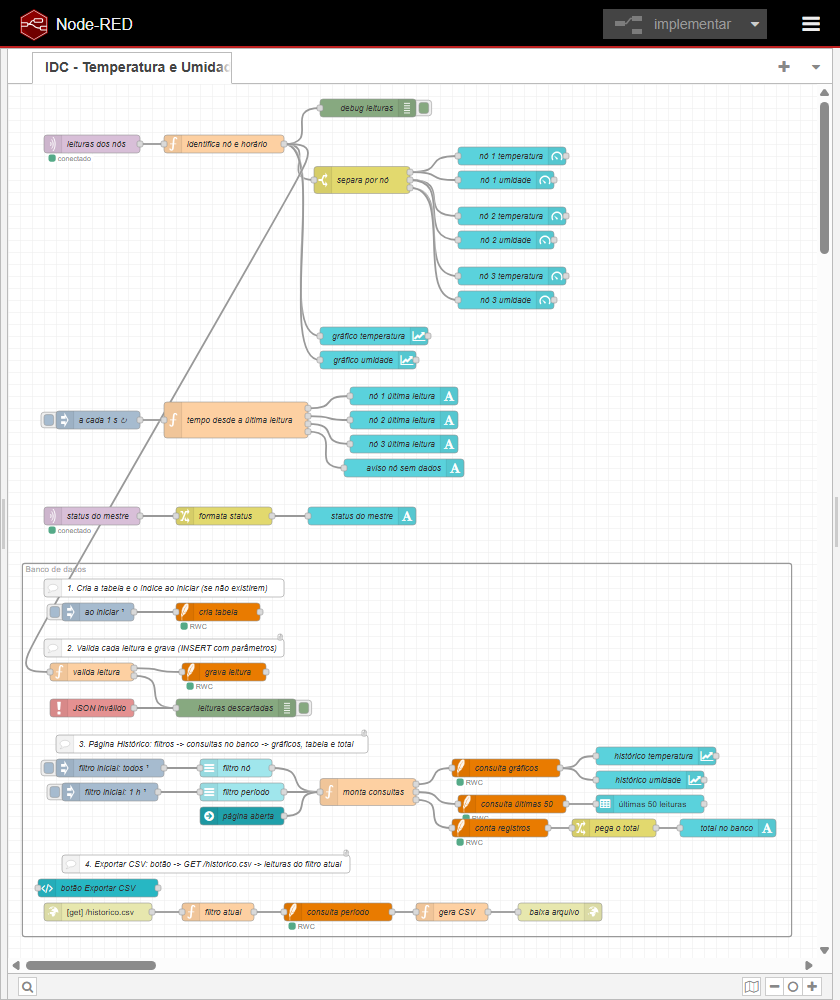
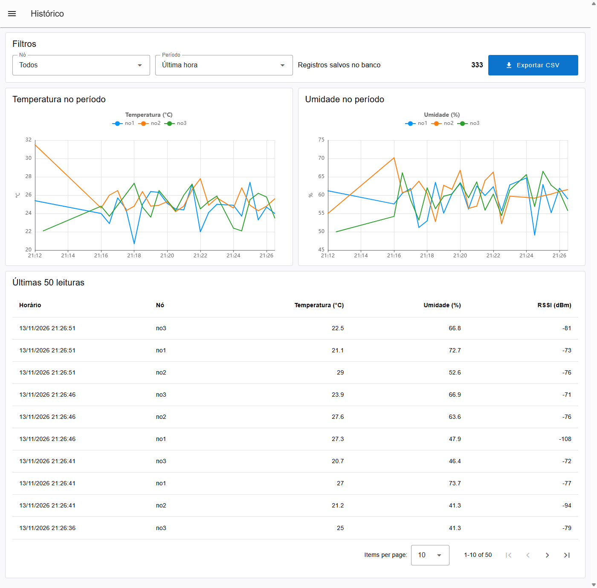
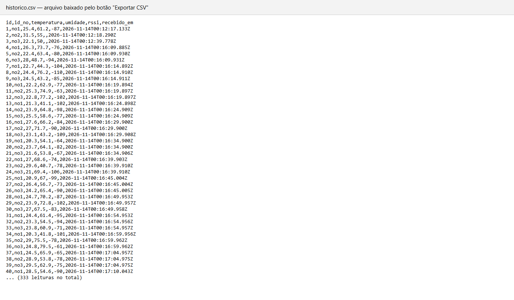
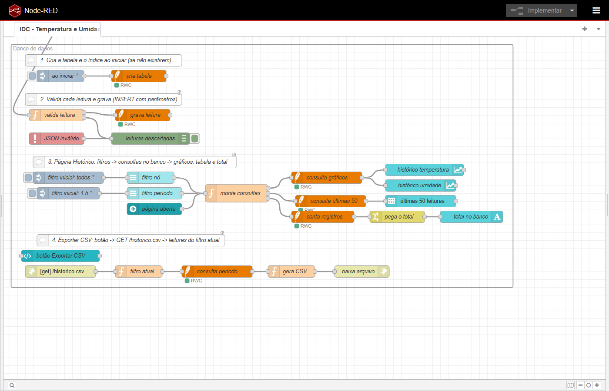

# IDC – Etapa de nuvem (Node-RED + MQTT)

Projeto final de Internet das Coisas – ICT/Unifesp, São José dos Campos.

Três nós escravos medem temperatura e umidade e enviam as leituras via LoRa para um nó mestre.
O mestre publica as leituras via MQTT. Este repositório contém **apenas a etapa de nuvem**:
o broker MQTT e o Node-RED com o dashboard.

```
 nó 1 ─┐
 nó 2 ─┼─ LoRa ─> mestre ── Wi-Fi / MQTT ──> Mosquitto :1883 ──> Node-RED :1880 ──> dashboard
 nó 3 ─┘
```

## Estrutura

```
docker-compose.yml          # sobe os dois serviços: mosquitto e nodered
mosquitto/mosquitto.conf    # broker na porta 1883, acesso anônimo
nodered/Dockerfile          # imagem do Node-RED + @flowfuse/node-red-dashboard + node-red-node-sqlite
nodered/flows.json          # o flow (carregado automaticamente ao subir)
simulador/simular_mestre.py # simula o nó mestre para testar sem hardware
docs/evidencias/            # capturas de tela do funcionamento
```

## Como rodar

Pré-requisito: Docker (com Docker Compose).

```sh
docker compose up -d --build
```

- Dashboard: <http://localhost:1880/dashboard> (páginas "Temperatura e Umidade" e "Histórico", no menu ☰)
- Editor do Node-RED: <http://localhost:1880>
- Broker MQTT: `<ip-do-computador>:1883` (é esse endereço que o mestre deve usar)

A pasta `nodered/` é montada como `/data` do Node-RED. Assim, o `flows.json` versionado é carregado
ao subir o container, e o que for alterado e implantado ("Deploy") no editor é gravado de volta no
`flows.json`, pronto para commit. Os demais arquivos que o Node-RED cria nessa pasta são ignorados pelo git.

Para parar: `docker compose down`.

## Contrato MQTT

O firmware do mestre deve seguir este contrato.

| Tópico | Payload | Quem publica |
|---|---|---|
| `idc/sensores/<id>/leituras` | JSON (abaixo) | mestre, uma mensagem por leitura de cada nó |
| `idc/mestre/status` | `online` ou `offline` (texto) | mestre |

**Leituras.** `<id>` é `no1`, `no2` ou `no3`. Exemplo de payload:

```json
{"temperatura": 25.4, "umidade": 61.2, "rssi": -87}
```

| Campo | Tipo | Unidade | Obrigatório |
|---|---|---|---|
| `temperatura` | número | °C | sim |
| `umidade` | número | % | sim |
| `rssi` | número | dBm (RSSI do LoRa) | não |

**Status do mestre.** Ao conectar, o mestre publica `online` com *retain*. Na conexão ele registra um
Last Will no mesmo tópico com payload `offline` e *retain*: se o mestre cair, o broker publica `offline`
por ele. O *retain* faz o dashboard saber o status atual mesmo se for aberto ou reiniciado depois.

Configuração recomendada no mestre: broker na porta 1883, sem usuário/senha, QoS 0 nas leituras,
QoS 1 + retain no status, e um `client_id` único (ex.: `idc-mestre`).

## O flow no Node-RED

1. **mqtt in** `idc/sensores/+/leituras`, com saída já como JSON parseado.
2. **function "identifica nó e horário"**: extrai o id do tópico (`msg.no`), anexa o horário de
   recebimento (`msg.recebido`) e guarda esse horário no contexto do flow.
3. **switch "separa por nó"**: envia cada leitura para os gauges do seu nó. Cada gauge lê o
   campo do payload que exibe (`payload.temperatura` ou `payload.umidade`), sem código.
4. **ui-chart** de temperatura e de umidade: uma série por nó (`msg.no`), guardando os últimos 30 min.
5. **inject a cada 1 s + function "tempo desde a última leitura"**: atualiza o texto "há X s" de cada
   nó e o aviso de **nó sem dados** quando um nó passa de 60 s sem enviar (ou nunca enviou).
6. **mqtt in** `idc/mestre/status` + **change** (JSONata): mostra 🟢 online / 🔴 offline.
7. **debug** com as leituras recebidas, para ajudar nos testes.
8. Grupo **Banco de dados**: grava as leituras no SQLite e alimenta a página Histórico
   (detalhes na seção abaixo).

## Testando sem o hardware

### Simulador do mestre (Python)

```sh
pip install -r simulador/requirements.txt
python simulador/simular_mestre.py              # broker em localhost
python simulador/simular_mestre.py 192.168.0.10 # outro broker
```

O simulador publica `online` em `idc/mestre/status` (com Last Will `offline`) e, a cada 5 s, uma
leitura aleatória para `no1`, `no2` e `no3`. Com Ctrl+C ele publica `offline` e sai; se for morto à
força, o broker publica o `offline` pelo Last Will.

### Com `mosquitto_pub`

Com o `mosquitto_pub` instalado na máquina:

```sh
mosquitto_pub -h localhost -t idc/mestre/status -m online -r
mosquitto_pub -h localhost -t idc/sensores/no1/leituras -m '{"temperatura": 25.4, "umidade": 61.2, "rssi": -87}'
mosquitto_pub -h localhost -t idc/mestre/status -m offline -r
```

Sem instalar nada, usando o cliente que já vem no container do broker:

```sh
docker compose exec mosquitto mosquitto_pub -h localhost -t idc/sensores/no2/leituras -m '{"temperatura": 31.5, "umidade": 55.0}'
```

Para ver tudo o que passa no broker:

```sh
docker compose exec mosquitto mosquitto_sub -h localhost -t 'idc/#' -v
```

## Evidências de funcionamento

Testes feitos com o simulador em 13/11/2026 (`docs/evidencias/`):

**Simulador rodando**: mestre online, os três nós atualizando gauges e gráficos, "há 2 s" em cada nó.


**Simulador encerrado à força**: o Last Will publicou `offline`, e após mais de 60 s sem leituras
os três nós aparecem como "SEM DADOS".


Também foi verificado que uma mensagem enviada com `mosquitto_pub` (comando acima) chega ao flow
(nó *debug*).

**Flow completo no editor do Node-RED**: recepção MQTT, gauges e gráficos, "nó sem dados", status
do mestre e o grupo "Banco de dados".



> **Pendente:** quando o hardware estiver pronto, uma captura com o mestre real enviando dados.

## Banco de dados (desafio extra)

Todas as leituras válidas são gravadas em um banco **SQLite**, e a página **Histórico** do dashboard
consulta esse banco.

### Por que SQLite

- **Simples:** é só instalar o nó `node-red-node-sqlite` (no `nodered/Dockerfile`); não há container
  de banco, servidor, usuário ou senha para configurar.
- **Arquivo único:** o banco inteiro é o arquivo `/data/historico.db`. Como `/data` é a pasta
  `nodered/` do repositório, o arquivo fica em `nodered/historico.db` no computador e **sobrevive a
  reinícios** do container. Ele não vai para o git (`.gitignore`).
- **Suficiente para o volume do projeto:** 3 nós com uma leitura a cada poucos segundos.

### Esquema

A tabela e o índice são criados automaticamente quando o flow inicia (`CREATE ... IF NOT EXISTS`):

```sql
CREATE TABLE IF NOT EXISTS leituras (
    id INTEGER PRIMARY KEY AUTOINCREMENT,
    id_no TEXT NOT NULL,          -- no1, no2, no3
    temperatura REAL NOT NULL,    -- °C
    umidade REAL NOT NULL,        -- %
    rssi INTEGER,                 -- dBm, pode ser nulo
    recebido_em TEXT NOT NULL     -- ISO 8601 em UTC, horário do servidor (ex.: 2026-11-14T00:12:17.133Z)
);
CREATE INDEX IF NOT EXISTS idx_leituras_no_data ON leituras (id_no, recebido_em);
```

### Como funciona no flow (grupo "Banco de dados")

1. **Cria a tabela** ao iniciar.
2. **Valida e grava**: cada leitura com `temperatura` e `umidade` numéricas vira um `INSERT` com
   parâmetros (`msg.params`, sem concatenar strings). Mensagens com JSON inválido (capturadas por um
   nó *catch* no `mqtt in`) ou sem temperatura/umidade vão para o debug **"leituras descartadas"** e
   não são gravadas; o resto do flow continua funcionando.
3. **Página Histórico**: filtros de nó (todos, no1, no2, no3) e período (última hora, 24 h, 7 dias),
   gráficos de temperatura e umidade, tabela com as últimas 50 leituras do filtro e o total de
   registros no banco. As consultas rodam ao abrir a página e ao trocar um filtro. Nos gráficos cada
   ponto é a média de um intervalo (30 s na última hora, 12 min em 24 h, 84 min em 7 dias), para que
   o período de 7 dias não fique pesado; a tabela e o CSV trazem as leituras individuais.
4. **Exportar CSV**: o botão baixa `historico.csv` com as leituras do filtro atual. O mesmo arquivo
   pode ser baixado direto em <http://localhost:1880/historico.csv>.

### Consultar os dados manualmente

O container não tem o programa `sqlite3`, mas o arquivo está no computador em `nodered/historico.db`.
Ele pode ser aberto com o [DB Browser for SQLite](https://sqlitebrowser.org/) ou, com o `sqlite3`
instalado na máquina:

```sh
sqlite3 nodered/historico.db "SELECT COUNT(*) FROM leituras;"
sqlite3 nodered/historico.db "SELECT * FROM leituras ORDER BY id DESC LIMIT 10;"
```

Sem instalar nada, usando o Node.js de dentro do container:

```sh
docker compose exec nodered node -e "new (require('sqlite3').Database)('/data/historico.db').all('SELECT id_no, COUNT(*) AS n FROM leituras GROUP BY id_no', (e, r) => console.table(r))"
```

### Backup

O backup é a cópia do arquivo. Para garantir uma cópia consistente, pare o Node-RED antes:

```sh
docker compose stop nodered
cp nodered/historico.db backup-historico-2026-11-13.db
docker compose start nodered
```

Para restaurar, faça o caminho inverso (com o Node-RED parado, copie o backup para `nodered/historico.db`).
Para começar do zero, pare o Node-RED e apague `nodered/historico.db`; a tabela é recriada ao subir.

### Roteiro de demonstração (apresentação)

1. Subir tudo: `docker compose up -d --build`.
2. Rodar o simulador por alguns minutos: `python simulador/simular_mestre.py`.
3. Abrir <http://localhost:1880/dashboard>, ir em ☰ → **Histórico** e mostrar os gráficos, a tabela e
   o total de registros. Trocar o filtro de nó e de período. Clicar em **Exportar CSV**.
4. Anotar o total de registros e reiniciar os containers: `docker compose restart`.
5. Recarregar a página **Histórico**: as leituras de antes do reinício continuam lá e o total é o
   mesmo (ou maior, se o simulador continuou rodando).
6. (Opcional) Enviar uma mensagem malformada e mostrar que nada quebra; ela aparece no debug
   "leituras descartadas" do editor:
   `docker compose exec mosquitto mosquitto_pub -h localhost -t idc/sensores/no1/leituras -m 'isso nao e json'`

### Evidências

Testes feitos com o simulador em 13/11/2026 (`docs/evidencias/`). Mensagens malformadas (texto que
não é JSON, JSON sem umidade, temperatura como texto) foram descartadas sem afetar o flow.

**Antes do reinício**: simulador rodado por alguns minutos e encerrado; o banco tem 333 registros.


**Depois de `docker compose restart`**: os mesmos 333 registros, gráficos e tabela continuam lá.



**CSV exportado**: arquivo `historico.csv` baixado pelo botão "Exportar CSV" (cabeçalho + 333 leituras;
o print mostra as primeiras 40 linhas).



**Grupo "Banco de dados" no editor do Node-RED**



## Decisões de simplicidade

Por ser uma rede local de laboratório e para manter o projeto mínimo, **não há** autenticação, TLS
nem backend próprio. Os gráficos da página principal guardam apenas os últimos 30 min em memória;
o histórico completo fica no SQLite (seção acima), dentro do próprio Node-RED.
