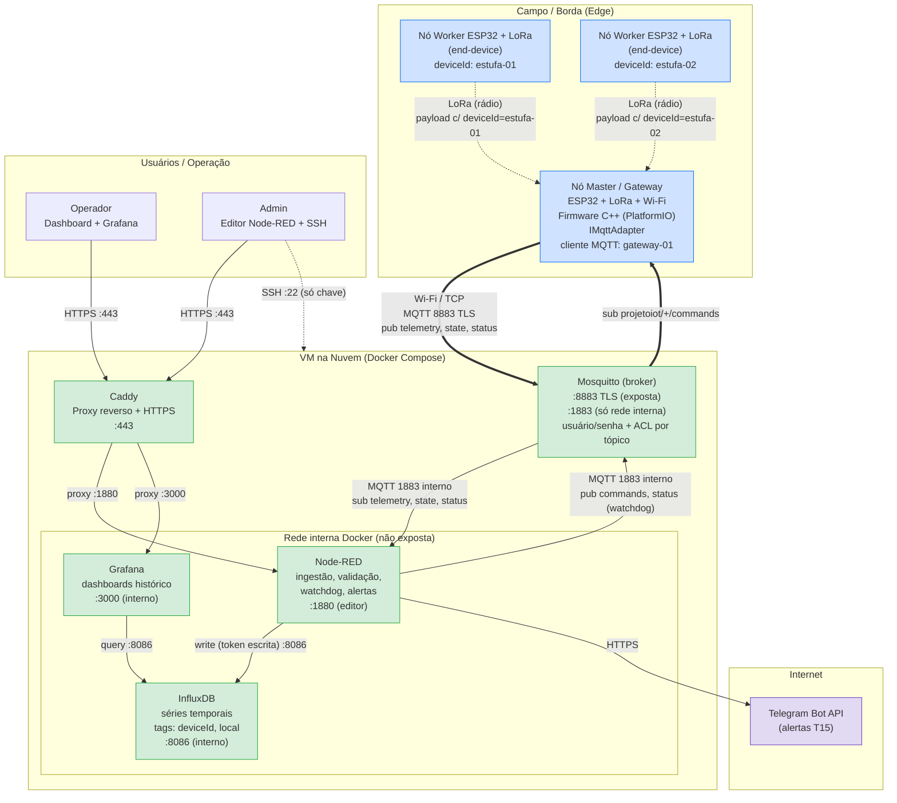

# Arquitetura do Sistema — v3

Entregável da tarefa **T01 — Definir a arquitetura e desenhar o diagrama**.
Critério de pronto: diagrama com componentes, portas e protocolos aprovado pela dupla.

Mudança em relação à v2: o broker passou do HiveMQ Cloud para o **Mosquitto na VM** (ver a decisão 1).

## Diagrama

Os nomes de tópico no diagrama estão abreviados. Os nomes completos, QoS e retain estão no [contrato MQTT](mqtt-contrato.md).

## Componentes

| Componente | Onde roda | Papel |
|---|---|---|
| Nó Worker (`estufa-01`, `estufa-02`, ...) | ESP32 + LoRa no campo | Lê sensores e envia por LoRa ao Master. Não tem Wi-Fi nem identidade MQTT própria. |
| Nó Master (`gateway-01`) | ESP32 + LoRa + Wi-Fi | Recebe pacotes LoRa, extrai o `deviceId` de origem e publica no Mosquitto. Repassa comandos aos Workers. Único cliente MQTT de campo. |
| Mosquitto | VM, container Docker | Broker MQTT. Aceita conexões externas só na 8883 com TLS. Exige usuário e senha e aplica ACL por tópico. |
| Node-RED | VM, container Docker | Ingestão, validação/normalização, status online/offline dos Workers (watchdog), alertas, dashboard e envio de comandos. |
| InfluxDB | VM, container Docker | Armazena a telemetria validada (tags `deviceId` e `local`). |
| Grafana | VM, container Docker | Painéis de histórico e comparação entre dispositivos. |
| Caddy | VM, container Docker | Proxy reverso com HTTPS para o editor/dashboard do Node-RED e o Grafana. |
| Telegram Bot API | SaaS (internet) | Canal de entrega dos alertas. |

## Portas e protocolos

| Origem → Destino | Protocolo | Porta | Exposição |
|---|---|---|---|
| Worker → Master | LoRa (rádio) | — | Local, sem IP |
| Master ↔ Mosquitto | MQTT sobre TLS (Wi-Fi/TCP) | 8883 | Internet, com usuário e senha |
| MQTTX (testes) ↔ Mosquitto | MQTT sobre TLS | 8883 | Internet, com usuário e senha |
| Node-RED ↔ Mosquitto | MQTT | 1883 | Só rede interna Docker, com usuário e senha |
| Node-RED → InfluxDB | HTTP (API v2) | 8086 | Só rede interna Docker |
| Grafana → InfluxDB | HTTP (API v2) | 8086 | Só rede interna Docker |
| Caddy → Node-RED | HTTP | 1880 | Só rede interna Docker |
| Caddy → Grafana | HTTP | 3000 | Só rede interna Docker |
| Usuários → Caddy | HTTPS | 443 | Internet |
| Admin → VM | SSH (só chave) | 22 | Internet |
| Node-RED → Telegram | HTTPS | 443 | Saída da VM para a internet |

Firewall da VM: entrada aberta apenas em **22**, **443** e **8883**. A 1883 não é publicada pelo Docker, então só os containers da mesma rede chegam nela.

O certificado TLS da 8883 usa o mesmo domínio configurado para o Caddy na T08.

## Tópicos MQTT

Resumo. A definição completa, com QoS, retain, payloads e ACL, está no [contrato MQTT](mqtt-contrato.md) (T02).

| Tópico | Quem publica | Quem assina |
|---|---|---|
| `projetoiot/{deviceId}/telemetry` | Master (em nome de cada Worker) | Node-RED |
| `projetoiot/{deviceId}/commands` | Node-RED | Master |
| `projetoiot/{deviceId}/state` | Master (em nome do Worker com atuador) | Node-RED |
| `projetoiot/{deviceId}/status` | Master (LWT do `gateway-01`) e Node-RED (watchdog dos Workers) | Node-RED e dashboard |

## Decisões tomadas

1. **Broker: Mosquitto na VM**, com TLS na 8883, usuário e senha e ACL por tópico ([ADR 0005](adr/0005-mosquitto-logical-device-id.md)).
   - Substitui o HiveMQ Cloud, escolhido na v2 deste documento.
   - Motivos:
     - O plano gratuito do HiveMQ Cloud (Serverless) não aceita clusters novos e para de funcionar em 31/12/2026, antes do fim do projeto ([HiveMQ Cloud Serverless End of Life](https://docs.hivemq.com/hivemq-cloud/serverless-end-of-life.html)).
     - Mesmo antes disso, o plano gratuito só permite uma permissão por credencial, sem ACL por tópico.
     - O Mosquitto é gratuito, não tem prazo de validade e atende a T07, a T09 e a T28 como estão escritas.
2. **Topologia Master-Worker com Workers LoRa reais** (ADR 0004). Só o Master tem Wi-Fi e fala MQTT.
3. **`deviceId` lógico**, não MAC ([ADR 0005](adr/0005-mosquitto-logical-device-id.md)).
   - Workers: `estufa-01`, `estufa-02`, ... O ID é configurado em cada Worker e viaja dentro do pacote LoRa.
   - Master: `gateway-01`, usado como identidade do cliente MQTT (usuário, ACL, LWT).
   - Motivo: o ID continua o mesmo se uma placa for trocada, é legível nos dashboards e serve direto como tag no InfluxDB e como chave da ACL.
4. **Stack de nuvem em Docker Compose** na VM: Mosquitto, Node-RED, InfluxDB, Grafana e Caddy. Só o Caddy (443) e o Mosquitto (8883) ficam expostos.

## Impacto no kanban

Com o Mosquitto, as tarefas T05, T06, T07 e T09 voltaram ao escopo original do kanban:

- **T05**: firewall aberto em 22, 443 e 8883.
- **T06**: o `docker-compose.yml` sobe Node-RED, Mosquitto, InfluxDB, Grafana e Caddy.
- **T07**: configurar usuários e ACL no Mosquitto, conforme a seção 5 do [contrato MQTT](mqtt-contrato.md).
- **T09**: ativar TLS na 8883 e manter a 1883 só na rede interna.
