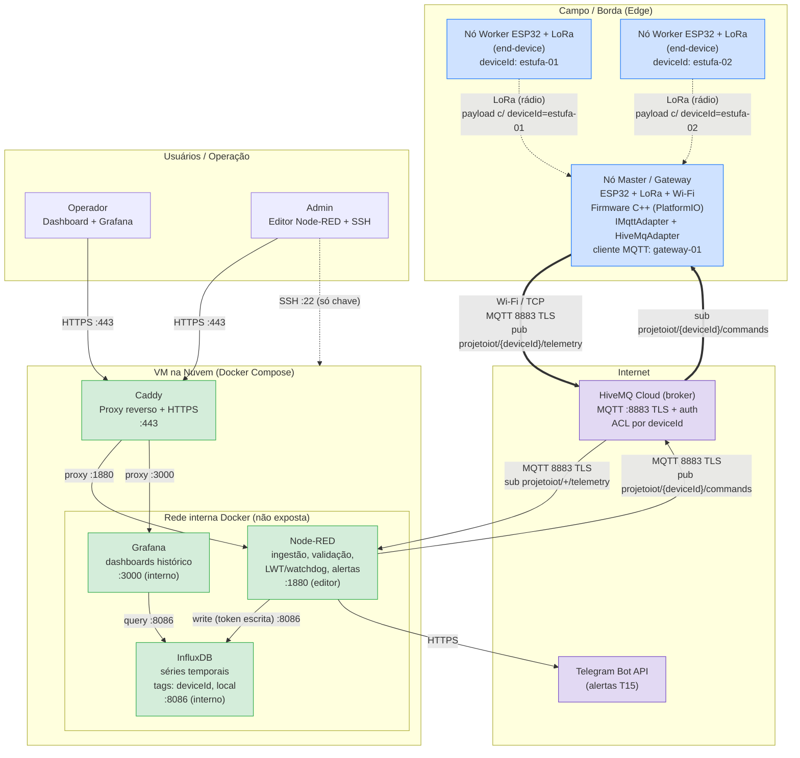

# Arquitetura do Sistema — v2

Entregável da tarefa **T01 — Definir a arquitetura e desenhar o diagrama**.
Critério de pronto: diagrama com componentes, portas e protocolos aprovado pela dupla.

## Diagrama

## Componentes

| Componente | Onde roda | Papel |
|---|---|---|
| Nó Worker (`estufa-01`, `estufa-02`, ...) | ESP32 + LoRa no campo | Lê sensores e envia por LoRa ao Master. Não tem Wi-Fi nem identidade MQTT própria. |
| Nó Master (`gateway-01`) | ESP32 + LoRa + Wi-Fi | Recebe pacotes LoRa, extrai o `deviceId` de origem e publica no HiveMQ. Repassa comandos aos Workers. Único cliente MQTT de campo. |
| HiveMQ Cloud | SaaS (internet) | Broker MQTT com TLS, autenticação e ACL por `deviceId`. |
| Node-RED | VM, container Docker | Ingestão, validação/normalização, status online/offline (LWT + watchdog), alertas, dashboard e envio de comandos. |
| InfluxDB | VM, container Docker | Armazena a telemetria validada (tags `deviceId` e `local`). |
| Grafana | VM, container Docker | Painéis de histórico e comparação entre dispositivos. |
| Caddy | VM, container Docker | Proxy reverso com HTTPS para o editor/dashboard do Node-RED e o Grafana. |
| Telegram Bot API | SaaS (internet) | Canal de entrega dos alertas. |

## Portas e protocolos

| Origem → Destino | Protocolo | Porta | Exposição |
|---|---|---|---|
| Worker → Master | LoRa (rádio) | — | Local, sem IP |
| Master ↔ HiveMQ Cloud | MQTT sobre TLS (Wi-Fi/TCP) | 8883 | Internet, com usuário/senha |
| Node-RED ↔ HiveMQ Cloud | MQTT sobre TLS | 8883 | Saída da VM para a internet |
| Node-RED → InfluxDB | HTTP (API v2) | 8086 | Só rede interna Docker |
| Grafana → InfluxDB | HTTP (API v2) | 8086 | Só rede interna Docker |
| Caddy → Node-RED | HTTP | 1880 | Só rede interna Docker |
| Caddy → Grafana | HTTP | 3000 | Só rede interna Docker |
| Usuários → Caddy | HTTPS | 443 | Internet |
| Admin → VM | SSH (só chave) | 22 | Internet |
| Node-RED → Telegram | HTTPS | 443 | Saída da VM para a internet |

Firewall da VM: entrada aberta apenas em **22** e **443**. Como o broker é o HiveMQ Cloud, a VM não precisa abrir a 8883 para entrada (o Node-RED só faz conexão de saída).

## Tópicos MQTT

| Tópico | Direção | Quem publica | Quem assina |
|---|---|---|---|
| `projetoiot/{deviceId}/telemetry` | Campo → nuvem | Master (em nome de cada Worker) | Node-RED (`projetoiot/+/telemetry`) |
| `projetoiot/{deviceId}/commands` | Nuvem → campo | Node-RED | Master |

A convenção detalhada (QoS, retain, LWT e exemplos de payload) é escopo da **T02**.

## Decisões tomadas

As decisões 1 e 3 estão registradas no [ADR 0005](adr/0005-hivemq-cloud-logical-device-id.md).

1. **Broker: HiveMQ Cloud** com TLS na 8883 e autenticação. O Mosquitto self-hosted foi descartado. O HiveMQ Public Sandbox (`broker.hivemq.com:1883`, ADR 0002) fica restrito a testes iniciais de desenvolvimento.
2. **Topologia Master-Worker com Workers LoRa reais** (ADR 0004). Só o Master tem Wi-Fi e fala MQTT.
3. **`deviceId` lógico**, não MAC.
   - Workers: `estufa-01`, `estufa-02`, ... O ID é configurado em cada Worker e viaja dentro do pacote LoRa.
   - Master: `gateway-01`, usado como identidade do cliente MQTT (usuário, ACL, LWT).
   - Motivo: o ID continua o mesmo se uma placa for trocada, é legível nos dashboards e serve direto como tag no InfluxDB e como chave da ACL.
4. **Stack de nuvem em Docker Compose** na VM: Node-RED, InfluxDB, Grafana e Caddy. Só o Caddy (443) fica exposto.

## Impacto no kanban

Com o broker no HiveMQ Cloud, estas tarefas mudam de escopo:

- **T06**: o `docker-compose.yml` sobe Node-RED, InfluxDB, Grafana e Caddy (sem Mosquitto).
- **T07**: passa a ser "configurar usuários e ACL no HiveMQ Cloud" (`gateway-01` publica em `projetoiot/+/telemetry` e assina `projetoiot/+/commands`; Node-RED faz o inverso).
- **T05 / T09**: a 8883 não precisa ser aberta na VM. O TLS do MQTT é fornecido pelo HiveMQ Cloud; a tarefa vira "conectar firmware e Node-RED ao HiveMQ Cloud via 8883 com TLS".
